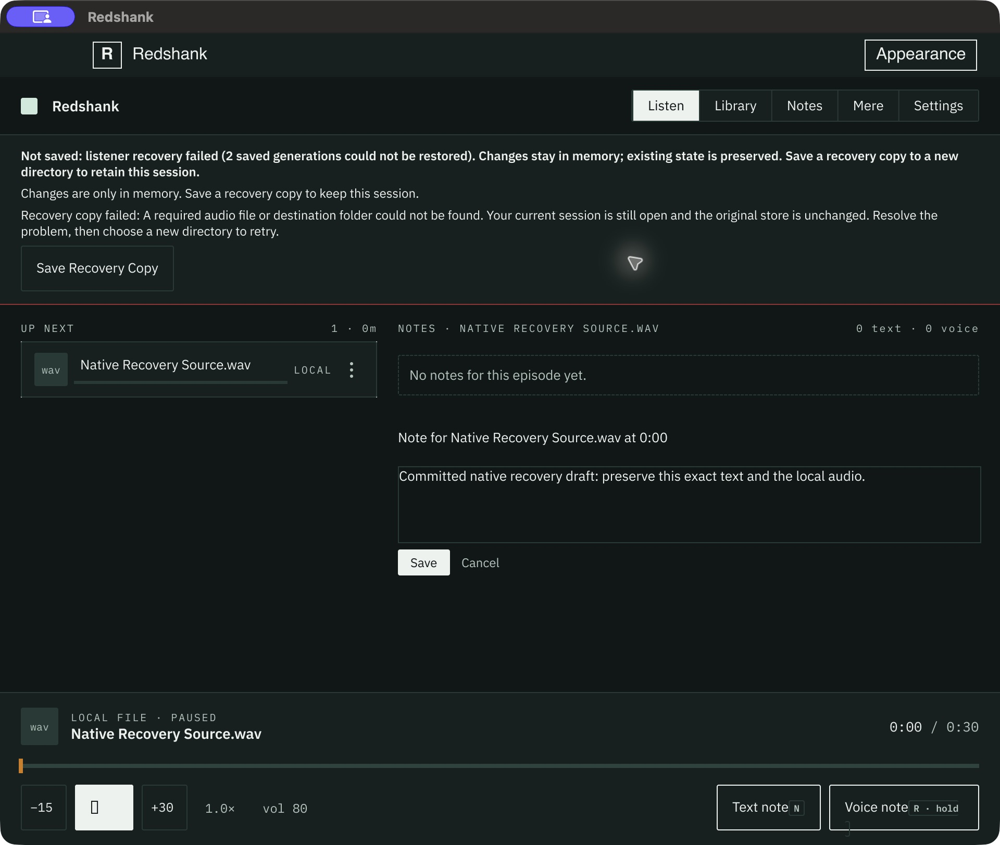
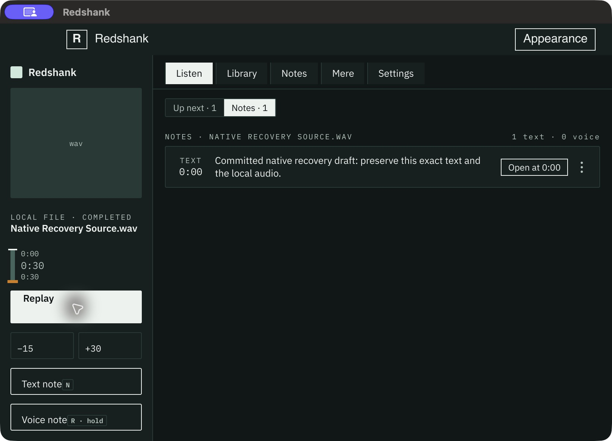

# D3 native recovery and fresh-process reopen

Started October 21; completed October 22, 2026, America/New_York.
Qualified committed source: `94583610752dce03853bb1bf132175121e7c79eb`.
The locked macOS desktop binary SHA256 is
`c18e11ef3df7a077d79d31a229abe6fff8a7dbb704df4c958ccd26b3de557855`.
Source and receipt are published through `428dd7ad`; the [publication record](publication.json) verifies the remote ref and exact source/evidence bytes.

The exercise used a real LaunchServices application and the native macOS Save
panel, operated through CUA. Listener, appearance, theme library and media paths
were isolated under `/Users/markik/Code/testing/woodshed-redshank-recovery-native-20261021`.
The failed listener held two invalid published generations and a pending file.
The media fixture was a 30-second, mono, 16 kHz, signed 16-bit silent WAV, made
with Python's `wave` writer and 960,000 zero sample bytes. No microphone was used.

| Native action | Observed result |
| --- | --- |
| Open Save Recovery Copy, then Cancel | Real Cocoa panel closes; exact unsaved editor text remains. |
| Choose a new directory inside the failed original | Copy refuses, no destination is created, draft remains. |
| Make the referenced WAV unavailable, then copy outside the original | Copy fails, publishes no model, retains the draft and offers retry. |
| Native Close, then Keep Working | All three choices are visible; Keep Working retains the exact editor. |
| Restore the source WAV; Close, then Save Recovery Copy | New directory contains the exact draft, selected item, queue, target/representation identity and byte-identical WAV. The original process exits zero. |
| Make original WAV unavailable again; launch a separate process against the copy | Native rail layout shows the saved note and 30-second audio. Open at 0:00 succeeds and copied audio reaches COMPLETED/Replay at 0:30. The reopened process exits zero. |

Original invalid generations and the pending file remain byte-for-byte identical
through the whole exercise. The separate reopen retained exact annotation,
library, selection and queue fields; ordinary progress/session saves in the copy
are expected and do not authorize writes to the failed original.

The initial probe exposed a real UX defect: failures displayed Rust `Io(...)`
debug internals. The committed fix gives readable missing-file, destination,
permission and encoding causes, preserves useful domain refusal text, and says
the live session remains open. The existing production failed-copy regression
now checks that the protected-destination cause survives without the debug
wrapper. The complete native flow above was rerun after that fix was committed.

Validation:

- Scoped recovery gate: 10 passes. Full desktop gate: **92 passes, one existing
  ignore**. Overlapping scoped cases are not added to the distinct total.
- Locked desktop build passes on the exact committed source.
- **Ten accepted native captures**, at 960 × 780 logical source size and
  820 × 560 logical fresh-reopen size. Seven initial probe captures are retained
  separately; they are not final acceptance for the repaired message.
- The coordinating owner reviewed all accepted captures. An independent reader
  reviewed the exact source diff and six decisive captures: cancellation,
  destination refusal, missing media, close choices, fresh reopen and completion.
  No remaining must-fix findings were reported.

Representative native evidence:

[receipt.json](receipt.json) binds the commands, process exits, source/binary
identity and image hashes. [source.json](source.json) records 74 source/config/
lock hashes. [copy-before-reopen.json](observations/copy-before-reopen.json)
freezes the copied model before native reopen;
[final-files.json](observations/final-files.json) records the final inventory and
model. Raw process receipts/logs are unchanged byte copies with their original
absolute paths preserved. CUA supplied JPEG image bytes; packaged `.jpg`
extensions are corrected without transcoding those bytes.

Run `python3 validation/redshank-recovery-native_20261021/verify.py` from the
repository root to check packaged image/log hashes, real process exits and
ordering, desktop outcomes, original-file hashes and exact retained model/media
facts. It needs no live profile, app launch or original external fixture.

Tool observations are preserved in the receipt. A stale AX index was refreshed
before actual chooser cancellation. An initial post-exit AX query launched an
empty observation window, which was immediately closed and excluded. The final
source/reopen process exits were checked without querying AX after exit. An
optional pause observation timed out while the reopened file played; its partial
capture is excluded, and the stable final completed state was separately captured.

This qualifies the tested macOS recovery, native chooser, local-media copy and
fresh-process reopening. Windows/Linux, native cached/voice-media copy, screen
reader/IME, physical audio and microphone capture remain separate. The prior
storage CPU evidence still covers cached/voice-blob copying. P5a ownership and
source are untouched.
